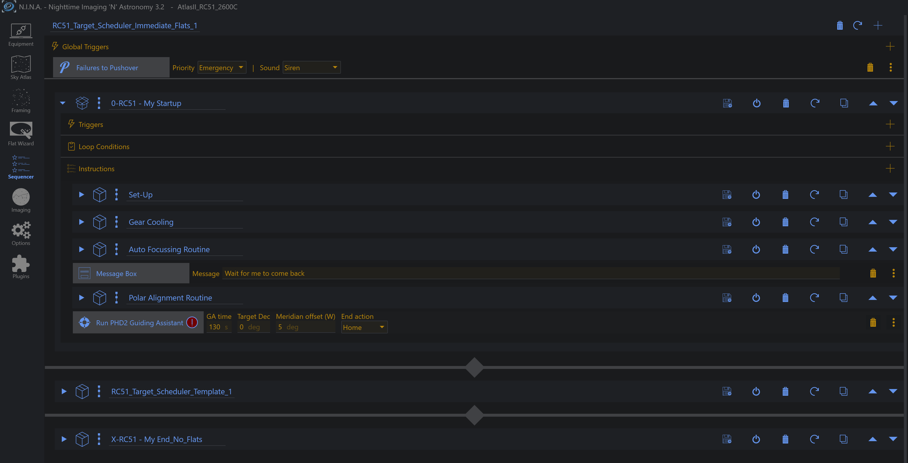
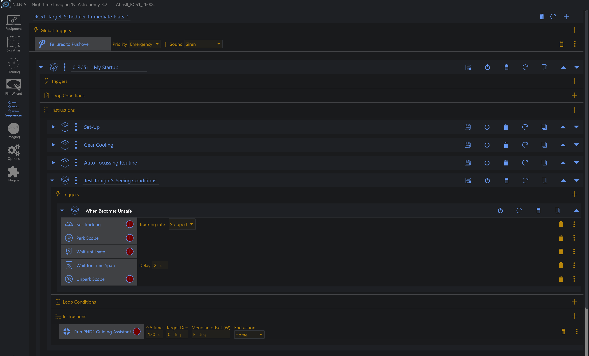
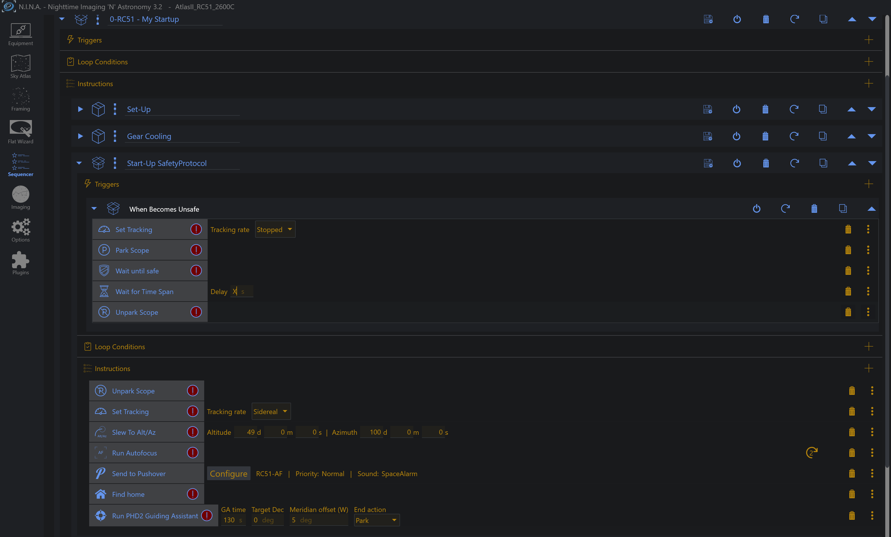

# Example Sequences

> **Disclaimer:** The templates below are examples only, provided to illustrate one way of
> wiring this plugin into a startup sequence. They are not validated for your specific mount,
> observatory, or safety hardware. Before running any of them unattended, thoroughly test the
> safety behavior of your own equipment in your own environment. No warranty is provided, and
> no liability is accepted for any damage to equipment resulting from their use.

Three real-world setups showing where "Run PHD2 Guiding Assistant" fits, depending on how
exposed the mount is to a closing roof.

## Under Open Skies

A simple, semi-fixed rig - on a trolley, or fully assembled and carried outside - imaged under
open sky with no roof or dome in the loop. The instruction runs as a plain step in the startup
sequence, right after polar alignment, with no extra safety wrapping beyond N.I.N.A.'s own
global failure handling.

## Under Roof, With Clearance

A fixed rig in an observatory where the mount has full clearance to move once the roof is open.
Minimal safety protocol is needed: the Guiding Assistant step is wrapped in its own instruction
set, `Test Tonight's Seeing Conditions`, with a "When Becomes Unsafe" trigger (stop tracking ->
park -> wait until safe -> unpark) around just that one step.

**Template:** [`Test Tonight's Seeing Conditions.template.json`](templates/Test%20Tonight's%20Seeing%20Conditions.template.json)

## Under Roof, No Clearance

A fixed rig where any mount movement - not just the Guiding Assistant run - risks hitting the
roof or walls before it's fully open. Here the whole startup routine (unpark, slew to the
calibration spot, autofocus, home, then run the Guiding Assistant) is wrapped in one safety
envelope, `Start-Up SafetyProtocol`, since every one of those steps moves the mount.

**Template:** [`Start-Up SafetyProtocol.template.json`](templates/Start-Up%20SafetyProtocol.template.json)

## Using these templates

1. Download the `.template.json` file(s) above.
2. Copy them into your N.I.N.A. Sequencer templates folder - check **Options -> General ->
   Sequence Templates Folder** for the exact path on your machine (commonly
   `Documents\N.I.N.A\Templates`).
3. Reopen the Sequencer - the template appears in the Templates list, ready to drag into your
   own sequence.
4. Adjust GA time / Target Dec / Meridian offset / End action, and every safety trigger step, to
   match your own rig and site before running - see the disclaimer above.

## A warning about End action

**If your mount driver cannot find home, `Auto` parks it - and a park latches the mount.**

`End action = Auto` chooses Find home where the driver supports it and falls back to **Park**
where it does not. EQMOD, which drives every Sky-Watcher and Orion mount, reports
`CanFindHome = False`, so on those mounts Auto parks every time.

A latched mount ignores every motion command until something unparks it. **Whatever follows
this instruction must issue `Unpark Scope` first** - and that includes the "Under Open Skies"
example above, which has no safety wrapper and therefore nothing that would unpark for you.

Worse, it does not look like a fault. Where the mount physically stops is the park position set
in your *driver*, not something the plugin chooses. EQMOD's first park option is called *"Park
at Home position"* - select that and the mount travels to the home position and parks there. It
ends up exactly where a successful Find home would have left it, and it is latched.

Confirmed on hardware, 2026-09-04:

| End action | EQMOD result |
|---|---|
| `Home` | Error - the mount stays where the run finished |
| `Auto` | Parks, at whatever the driver's Park tab specifies |
| `Park` | Parks, same destination |

With EQMOD there is one park destination and no separate home, so the roof decision moves out
of your sequence and into the driver: **clearance** - set the driver's park to *Park at Home
position*; **no clearance** - set it to your predefined safe position. Either way, unpark
afterwards.

See [mount-capabilities/mount-capabilities.md](mount-capabilities/mount-capabilities.md) for
what is known about individual drivers, and for the read-only tool that profiles yours.
